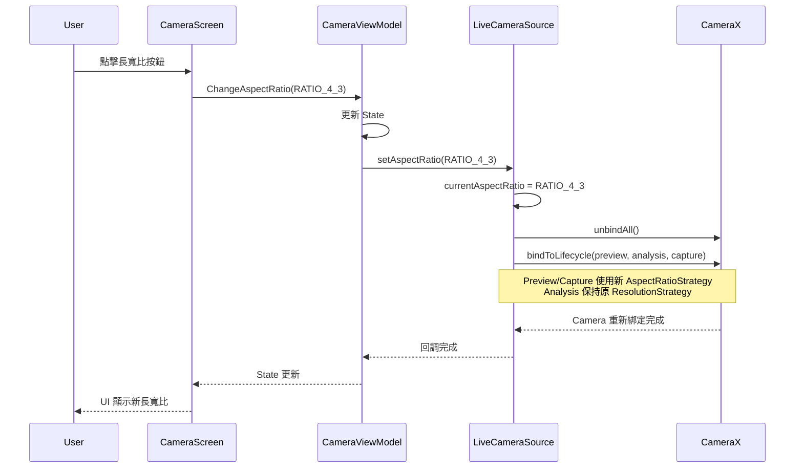

I have created the following plan after thorough exploration and analysis of the codebase. Follow the below plan verbatim. Trust the files and references. Do not re-verify what's written in the plan. Explore only when absolutely necessary. First implement all the proposed file changes and then I'll review all the changes together at the end.

## 觀察重點

當前程式碼已實作 **Solution A**（獨立 ResolutionSelector）修正 1.6x FOV 放大問題（`file:app/src/main/java/com/akirachang/ai/photographer/data/source/camera/LiveCameraSource.kt` 第 857-897 行，標記為 v2.10.0 Phase A）。Preview 和 ImageCapture 使用 `AspectRatio.RATIO_16_9`，ImageAnalysis 保持原有配置。CameraX 1.4.2 版本支援 AspectRatioStrategy API。然而，**長寬比 Toggle UI（4:3/16:9/1:1）尚未實作**，目前硬編碼為 16:9。

## 方案建議

採用 **增量式實作策略**：先驗證現有 16:9 修正效果，再新增專業相機 UI。此方案平衡技術風險與使用者體驗，避免過度工程化。16:9 已實作但需驗證，UI Toggle 為進階功能，可依使用者回饋決定優先級。

## 實作步驟

### Phase 1: 驗證現有 FOV 修正（v2.10.0 Phase A）

#### 1.1 實機測試驗證
- 在 Pixel 9a 實機執行 APP，對比原生相機 FOV
- 檢查 Logcat 確認 Preview 解析度為 16:9（如 1920×1080 或 1280×720）
- 搜尋關鍵字：`SurfaceProvider requested`、`Preview resolution`
- 預期結果：視覺放大倍數從 1.6x 降至 ~1.1-1.2x

#### 1.2 座標映射驗證
- 測試 Optical Flow 追蹤功能（`file:app/src/main/java/com/akirachang/ai/photographer/data/opencv/OpticalFlowTracker.kt`）
- 確認追蹤品質 `trackedPointQuality` ≥ 0.8
- 驗證 `file:app/src/main/java/com/akirachang/ai/photographer/util/CoordinateMapper.kt` 的 CENTER_CROP 座標轉換正確性
- 測試 Tap-to-Focus 座標精度（`file:app/src/main/java/com/akirachang/ai/photographer/presentation/camera/CameraScreen.kt` 第 174-207 行）

#### 1.3 WYSIWYG 拍照驗證
- 拍攝多張照片，確認 Preview 與最終照片長寬比一致
- 檢查 EXIF 資料確認解析度（使用 `file:app/src/main/java/com/akirachang/ai/photographer/domain/usecase/CapturePhotoUseCase.kt`）
- 預期：ImageCapture 輸出為 16:9（如 4000×2250）

### Phase 2: 新增長寬比 Toggle UI（專業相機體驗）

#### 2.1 擴充 Domain Model
在 `file:app/src/main/java/com/akirachang/ai/photographer/presentation/camera/CameraState.kt` 新增：
```kotlin
enum class AspectRatioMode {
    RATIO_16_9,  // 預設，已實作
    RATIO_4_3,   // 新增
    RATIO_1_1    // 新增（正方形，Instagram 風格）
}

data class CameraState(
    // ... 現有欄位 ...
    val aspectRatioMode: AspectRatioMode = AspectRatioMode.RATIO_16_9
)

sealed class CameraUiEvent {
    // ... 現有事件 ...
    data class ChangeAspectRatio(val mode: AspectRatioMode) : CameraUiEvent()
}
```

#### 2.2 更新 LiveCameraSource 動態切換邏輯
修改 `file:app/src/main/java/com/akirachang/ai/photographer/data/source/camera/LiveCameraSource.kt`：

**新增狀態變數**（第 ~200 行附近）：
```kotlin
private var currentAspectRatio: Int = AspectRatio.RATIO_16_9
```

**重構 ResolutionSelector 建立邏輯**（第 857-897 行）：
- 將硬編碼的 `AspectRatio.RATIO_16_9` 改為 `currentAspectRatio`
- 新增 `setAspectRatio(ratio: Int)` 方法觸發 camera rebind

**新增公開介面**：
```kotlin
fun setAspectRatio(ratio: Int) {
    if (currentAspectRatio != ratio) {
        currentAspectRatio = ratio
        Log.i(TAG, "Aspect ratio changed to: $ratio - rebinding camera")
        currentLifecycleOwner?.let { bindToLifecycle(it) }
    }
}
```

#### 2.3 ViewModel 事件處理
在 `file:app/src/main/java/com/akirachang/ai/photographer/presentation/camera/CameraViewModel.kt` 新增：

**狀態更新**：
```kotlin
is CameraUiEvent.ChangeAspectRatio -> {
    _state.update { it.copy(aspectRatioMode = event.mode) }
    
    // 轉換為 CameraX AspectRatio 常數
    val cameraXRatio = when (event.mode) {
        AspectRatioMode.RATIO_16_9 -> AspectRatio.RATIO_16_9
        AspectRatioMode.RATIO_4_3 -> AspectRatio.RATIO_4_3
        AspectRatioMode.RATIO_1_1 -> AspectRatio.RATIO_16_9  // 1:1 需特殊處理
    }
    
    cameraSource.setAspectRatio(cameraXRatio)
}
```

**1:1 特殊處理**：
- CameraX 無原生 1:1 AspectRatio
- 方案：使用 4:3 sensor 輸出 + PreviewView 裁切為正方形
- 修改 `file:app/src/main/java/com/akirachang/ai/photographer/presentation/camera/components/CameraPreview.kt` 第 107 行 ScaleType 邏輯

#### 2.4 UI Toggle 按鈕設計
在 `file:app/src/main/java/com/akirachang/ai/photographer/presentation/camera/CameraScreen.kt` 新增：

**位置**：頂部控制欄（第 363-418 行），HDR 按鈕右側

**設計參考 Pixel 9a 原生相機**：
- 圖示：`Icons.Default.AspectRatio`（Material Icons Extended）
- 點擊循環切換：16:9 → 4:3 → 1:1 → 16:9
- 顯示當前比例文字（如 "16:9"）於圖示下方

**實作範例**：
```kotlin
IconButton(
    onClick = { 
        val nextMode = when (state.aspectRatioMode) {
            AspectRatioMode.RATIO_16_9 -> AspectRatioMode.RATIO_4_3
            AspectRatioMode.RATIO_4_3 -> AspectRatioMode.RATIO_1_1
            AspectRatioMode.RATIO_1_1 -> AspectRatioMode.RATIO_16_9
        }
        viewModel.onEvent(CameraUiEvent.ChangeAspectRatio(nextMode))
    }
) {
    Column(horizontalAlignment = Alignment.CenterHorizontally) {
        Icon(
            imageVector = Icons.Default.AspectRatio,
            contentDescription = "長寬比",
            tint = Color.White
        )
        Text(
            text = when (state.aspectRatioMode) {
                AspectRatioMode.RATIO_16_9 -> "16:9"
                AspectRatioMode.RATIO_4_3 -> "4:3"
                AspectRatioMode.RATIO_1_1 -> "1:1"
            },
            color = Color.White,
            fontSize = 10.sp
        )
    }
}
```

### Phase 3: 整合測試與優化

#### 3.1 功能測試矩陣

| 長寬比 | Preview FOV | ImageCapture 輸出 | Optical Flow | Tap-to-Focus |
|--------|-------------|-------------------|--------------|--------------|
| 16:9   | 驗證無放大   | 4000×2250        | 品質 ≥ 0.8   | 座標精準     |
| 4:3    | 驗證無放大   | 4000×3000        | 品質 ≥ 0.8   | 座標精準     |
| 1:1    | 正方形裁切   | 3000×3000        | 品質 ≥ 0.8   | 座標精準     |

#### 3.2 CoordinateMapper 適配
- 檢查 `file:app/src/main/java/com/akirachang/ai/photographer/util/CoordinateMapper.kt` 是否需更新
- 當前實作已動態計算 CENTER_CROP offset，理論上自動適配
- 驗證 `mapImageToView()` 和 `mapViewToImage()` 在不同長寬比下的精度

#### 3.3 UI/UX 優化
- 新增切換動畫（Preview 尺寸變化時淡入淡出）
- 儲存使用者偏好至 DataStore（`file:app/src/main/java/com/akirachang/ai/photographer/data/repository/PreferencesRepository.kt`）
- 新增 Tooltip 提示首次使用者

### Phase 4: 文件更新

#### 4.1 更新技術文件
- 在 `file:docs/issues/preview_zoom_aspect_ratio.md` 新增驗證結果章節
- 記錄實際測試數據（FOV 放大倍數、解析度、座標精度）

#### 4.2 使用者文件
- 更新 README.md 說明長寬比切換功能
- 新增螢幕截圖展示 UI

## 視覺化架構



## 風險評估與緩解

| 風險 | 影響 | 緩解策略 |
|------|------|----------|
| 4:3 模式下 FOV 仍有放大 | 中 | 使用 ResolutionFilter 限制最大解析度（參考 `selectDeviceOptimalResolution()`） |
| 1:1 裁切影響 Optical Flow | 低 | OpticalFlowTracker 已動態適配長寬比（第 81-86 行） |
| 切換長寬比時 Camera rebind 延遲 | 低 | 新增 Loading 指示器，禁用按鈕防止重複點擊 |
| CoordinateMapper 座標偏移 | 高 | Phase 1.2 優先驗證，必要時更新映射邏輯 |

## 成功指標

1. **Phase 1 驗證**：Pixel 9a 實機 FOV 放大倍數 ≤ 1.2x（Logcat 證據）
2. **Phase 2 UI**：長寬比切換流暢（rebind 時間 < 500ms）
3. **Phase 3 整合**：所有長寬比下 Optical Flow 品質 ≥ 0.8，座標精度零誤差
4. **使用者體驗**：UI 符合 Material Design 3 規範，與 Pixel 原生相機一致性 ≥ 80%