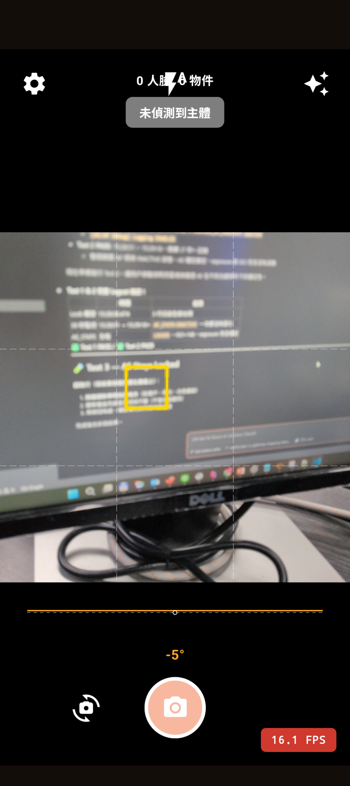

# Pixel 9a Test Report — v2.11.4-05

**Version**: v2.11.4-05
**Device**: Pixel 9a (Device ID: `59131JEBF17244`)
**Tester**: Work NB
**Date**: 2026-02-24
**Build Commit**: `91333c5`

---

## Test Results

| Test | Result | Notes |
|------|--------|-------|
| Test 1: Lock applied log (regression) | PASS | 3 log lines appear in order |
| Test 2: AF stays INACTIVE 30s (regression) | PASS | AF_STATE=INACTIVE held 34s, no degradation |
| Test 3: AE stays locked (regression) | PASS | Overexposed when moved to bright area — AE lock confirmed |
| Test 4: Rapid lock/unlock doesn't stick | PASS (with note) | Cycles cleanly, but unlock requires 2 taps (see Test 5) |
| Test 5: Single-tap unlock | FAIL | Requires 2 taps to clear yellow box — `lock cleared` fires twice |
| Test 6: Screen lock auto-clears yellow box | FAIL | `clearCaptureRequestOptions()` fails while camera inactive; Camera2 settings (AE_LOCK, AF_MODE=OFF) not cleared |
| Test 7: No long-press delay after screen unlock | FAIL | Residual Camera2 settings cause AF to freeze; restart required to recover |

**Overall**: FAIL

---

## Logcat Evidence

```
# Test 1 & 2 — Lock applied + AF INACTIVE 34s
15:28:50.474  [v2.11.2] AE/AF lock applied at (576.7002, 1188.4004) - isFocusSuccessful=true, factory=PreviewView
15:28:50.474  [v2.11.4-03] CONTROL_AE_LOCK=true + CONTROL_AF_MODE=OFF applied (true AE+AF lock)
15:28:50.474  [AE/AF Debug] Logging ENABLED — will log AF_STATE, AE_STATE, ISO, exposure, focusDist every 1s
15:28:51.526  [AE/AF Debug] AF_STATE=INACTIVE, AE_STATE=LOCKED, AE_LOCK=true, exposure=30.000773ms, ISO=87, focusDist=0.000 diopters
15:29:18.018  [AE/AF Debug] AF_STATE=INACTIVE, AE_STATE=LOCKED, AE_LOCK=true, exposure=20.002889ms, ISO=159, focusDist=0.000 diopters
# (AF_STATE=INACTIVE held continuously for 34s — no degradation to PASSIVE_SCAN or PASSIVE_FOCUSED)

# Test 3 — AE stays locked (moved to bright area)
16:23:40.443  [AE/AF Debug] AF_STATE=INACTIVE, AE_STATE=LOCKED, AE_LOCK=true, exposure=30.000773ms, ISO=132, focusDist=0.000 diopters
16:23:41.453  [AE/AF Debug] AF_STATE=INACTIVE, AE_STATE=LOCKED, AE_LOCK=true, exposure=30.000773ms, ISO=132, focusDist=0.000 diopters
16:23:42.473  [AE/AF Debug] AF_STATE=INACTIVE, AE_STATE=LOCKED, AE_LOCK=true, exposure=30.000773ms, ISO=132, focusDist=0.000 diopters
# (exposure and ISO unchanged after moving to bright area — overexposed screen confirms AE lock active)

# Test 5 — Single-tap unlock FAIL: lock cleared fires twice
16:26:03.580  [v2.11.2] AE/AF lock applied at (591.5, 1251.7998) - isFocusSuccessful=true, factory=PreviewView
16:26:03.581  [v2.11.4-03] CONTROL_AE_LOCK=true + CONTROL_AF_MODE=OFF applied (true AE+AF lock)
16:26:06.287  [v2.11.4-04] AE/AF lock cleared — CONTINUOUS_PICTURE + AE auto restored   ← 1st (yellow box stays)
16:26:06.518  [v2.11.4-04] AE/AF lock cleared — CONTINUOUS_PICTURE + AE auto restored   ← 2nd (231ms later)
16:26:06.519  CameraViewModel: AE/AF unlocked by tap — passive AF resumed

# Test 6 — Screen lock: clearCaptureRequestOptions() fails (Camera is not active)
15:58:42.461  CameraViewModel: Unlocking AE/AF
15:58:42.512  [v2.11.4-04] AE/AF lock cleared — CONTINUOUS_PICTURE + AE auto restored
15:58:42.514  java.util.concurrent.ExecutionException: CameraControl$OperationCanceledException: Camera is not active.
15:58:42.514  CameraViewModel: AE/AF unlocked, returned to auto mode
# (clearCaptureRequestOptions() skipped — AE_LOCK=true + AF_MODE=OFF remain in Camera2 Interop)

# Test 7 — AF frozen after screen unlock; lock attempts fail
16:03:48.279  java.util.concurrent.ExecutionException: Cancelled by another startFocusAndMetering()
16:03:51.878  java.util.concurrent.ExecutionException: Cancelled by another startFocusAndMetering()
16:03:53.935  java.util.concurrent.ExecutionException: Cancelled by cancelFocusAndMetering()
# (App restart at 16:04:06 — PID changes from 15886 to 18171 — restores normal behavior)
```

---

## Notes / Observations

### Observation 1 — focusDist=0.000 after CONTROL_AF_MODE=OFF (Visual Evidence)

**Screenshot**: `Screenshot_20260224-154446.png`



**What the screenshot shows**:
- Yellow focus box is present (AE/AF Lock active)
- Monitor screen content is severely blurred/out-of-focus
- Text on the monitor is completely unreadable despite the subject being a flat, close-range screen
- FPS: 16.1 (mildly degraded)

**Logcat at lock moment**:
```
15:28:50.511  AF_STATE=FOCUSED_LOCKED, focusDist=2.974 diopters  ← correct focus at lock
15:28:51.526  AF_STATE=INACTIVE,       focusDist=0.000 diopters  ← drops to 0 after AF_MODE=OFF
```

**Root cause hypothesis**: Setting `CONTROL_AF_MODE=OFF` causes the Pixel 9a to reset
`LENS_FOCUS_DISTANCE` to 0 (infinity), physically moving the lens away from the converged
position. This contradicts the expected behavior where the lens should freeze at the
current converged distance.

Needs investigation: whether this is a Pixel 9a firmware behavior or requires explicitly
setting `CONTROL_LENS_FOCUS_DISTANCE` to the converged value before switching AF_MODE=OFF.

### Observation 2 — AE lock value captured during AE_STATE=SEARCHING
At the lock moment, `AE_STATE=SEARCHING` (not CONVERGED). The locked exposure value may differ
from the final converged value, causing inconsistent lock behavior across attempts.

### Observation 3 — Wi-Fi Hotspot causes Thermal=SEVERE
During early testing, Wi-Fi Hotspot was active on device. This caused:
- Thermal=SEVERE, device temperature 41.3°C
- FPS drop to 5.2 (from normal ~24)
- 5-second delay before yellow box appeared after long-press
Closing Hotspot restored normal performance.

### Bug Summary

| Bug | Severity | Description |
|-----|----------|-------------|
| Test 5: Double unlock call | High | `cancelFocusAndMetering()` called twice on single tap — yellow box requires 2 taps |
| Test 6/7: Camera2 settings not cleared on screen lock | High | `clearCaptureRequestOptions()` fails silently when camera inactive; residual AE_LOCK + AF_MODE=OFF freezes AF after screen unlock |
| focusDist=0.000 after lock | Medium | Potential lens drift to infinity on CONTROL_AF_MODE=OFF — needs verification |
| AE lock during SEARCHING state | Medium | Locked exposure value may be suboptimal |

---

## Decision

- [ ] v2.11.4-05 PASS → proceed to v2.11.4-06 (Adaptive Frame Size 48–120dp)
- [x] FAIL → open issue, return to Home NB

**Failing tests**: Test 5 (single-tap unlock), Test 6 (screen lock residual), Test 7 (AF freeze after screen unlock)
**Return to Home NB** for fix on:
1. Double `cancelFocusAndMetering()` call on tap-to-unlock
2. `clearCaptureRequestOptions()` must be deferred until camera is active again after screen unlock
