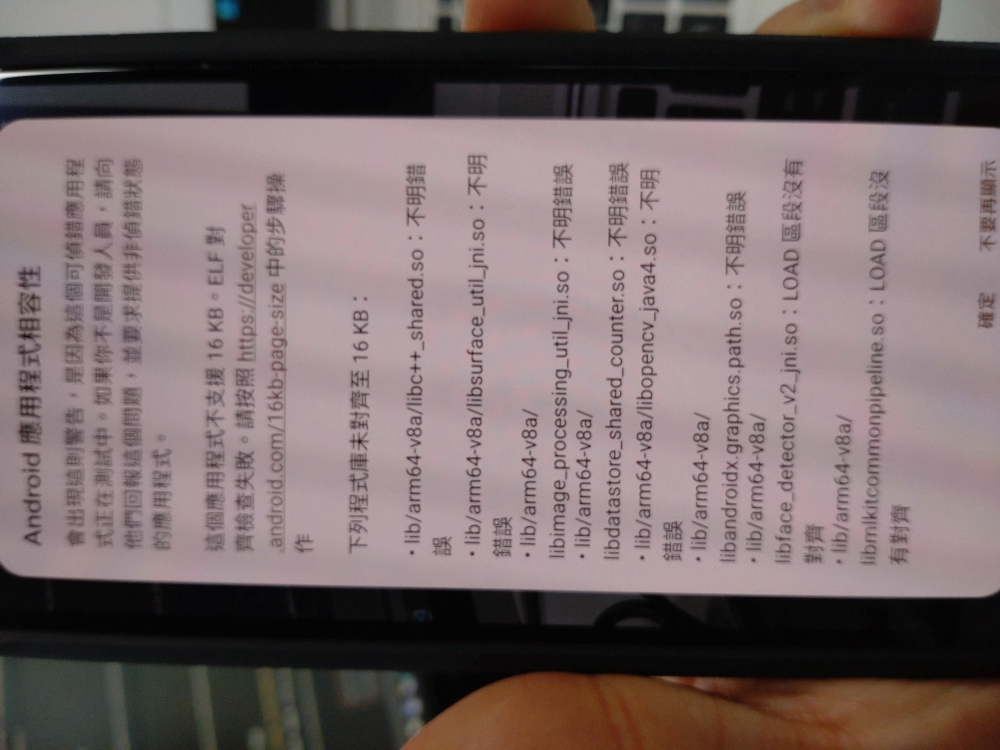

# v2.9.6 Phase 2.4 - Physical Devices Test Report

## 測試資訊

| 項目 | 內容 |
|------|------|
| **測試版本** | v2.9.6-phase2.4 (Build 56) |
| **測試日期** | 2026-01-27 |
| **測試裝置** | Google Pixel 9a, Sony Xperia 1 III (XQ-BT52) |
| **Android 版本** | Pixel 9a: Android 16 (API 36) / Sony: Android 12 (API 31) |
| **PAGE_SIZE** | 兩台皆為 4096 (4KB) |
| **測試人員** | User + Claude Code |
| **APK** | `app-device-debug.apk` (現場編譯, Build 56) |

---

## 測試總結

| Device | Android | Page Size | pageSizeCompat | PageSizeDialog | Functionality | Result |
|--------|---------|-----------|----------------|----------------|---------------|--------|
| Pixel 9a | 16 (API 36) | 4096 | ✅ enabled (val=32) | ❌ 仍出現 | ✅ 正常 | **FAIL** |
| Sony XQ-BT52 | 12 (API 31) | 4096 | ✅ enabled (val=32) | ✅ 無此檢查 | ✅ 正常 | **PASS** |

### 測試結論

- [x] ❌ **Pixel 9a 未通過** - `android:pageSizeCompat="enabled"` 未能消除 PageSizeMismatchDialog
- [x] ✅ **Sony 通過** - 跨裝置相容性驗證正常（Android 12 無 16KB 檢查）

---

## 測試詳細結果

### ⭐ 核心測試：PageSizeMismatchDialog 消除

| 檢查項目 | 預期結果 | 實際結果 | 狀態 |
|---------|---------|---------|------|
| APK 包含 pageSizeCompat 屬性 | ✅ 包含 | ✅ 包含 (val=32) | ✅ |
| PageSizeMismatchDialog 不出現 | ✅ 不出現 | ❌ **仍然出現** | ❌ FAIL |
| Logcat 無 PageSizeMismatch 紀錄 | ✅ 無 | ❌ **有紀錄** | ❌ FAIL |

**Logcat 證據**:
```
01-27 11:11:09.467 1830 1881 W AppWarnings: Showing PageSizeMismatchDialog for package com.akirachang.ai.photographer
```

**APK Manifest 證據** (aapt2 dump):
```
E: application (line=53)
  A: android:pageSizeCompat(0x010106ab)=32
```

### 結論

`android:pageSizeCompat="enabled"` 屬性已正確編譯入 APK，但 Android 16 系統**仍然顯示** PageSizeMismatchDialog。可能原因：

1. **pageSizeCompat 僅影響運行時行為**，不影響安裝/啟動時的 ELF 對齊檢查警告
2. **Android 16 的 AppWarnings 系統**可能在 pageSizeCompat 檢查之前就觸發對話框
3. **此裝置 PAGE_SIZE=4096**，但 Android 16 仍會前瞻性檢查 16KB 對齊
4. 上游原生函式庫（OpenCV、ML Kit）的 ELF segment 仍未 16KB 對齊，pageSizeCompat 無法改變此事實

---

## 裝置資訊

### Pixel 9a
```
Model:          Pixel 9a
Android:        16
API Level:      36
PAGE_SIZE:      4096
Device ID:      59131JEBF17244
```

### Sony Xperia 1 III
```
Model:          XQ-BT52
Android:        12
API Level:      31
PAGE_SIZE:      4096
Device ID:      HQ616R2713
```

---

## 功能驗證

### Pixel 9a

雖然 pageSizeCompat 未能消除警告，APP 功能在點擊「確定」後完全正常：

| 功能項目 | 狀態 | 備註 |
|---------|------|------|
| APP 安裝 | ✅ | Streamed Install, Success |
| APP 啟動 | ✅ | 點擊「確定」後正常啟動 |
| CameraViewModel 初始化 | ✅ | Preview + Guideline + Orientation 全部初始化 |
| OpenCV 載入 | ✅ | OpenCV 4.13.0 正常處理 |
| 解析度 | ✅ | 1280x720 (Pixel 升級) |
| FPS 效能 | ✅ | **28.7 FPS** (超越預期 18-22) |
| 丟幀率 | ✅ | 0.0% (完美) |
| 記憶體 | ✅ | Native=83MB, Java=29-97MB, Total=370-446MB |
| 熱節流 | ✅ | Thermal=NONE |
| 崩潰/異常 | ✅ | 無 fatal/crash/exception |

### FPS 效能詳細

| 時間點 | FPS | Dropped | Memory Total |
|--------|-----|---------|-------------|
| 啟動初期 | 18.8 | 0/630 (0.0%) | 370MB |
| +1s | 19.1 | 0/660 (0.0%) | 436MB |
| +2s | 28.7 | 0/690 (0.0%) | 416MB |
| +3s | 28.0 | 0/720 (0.0%) | 380MB |
| +5s | 28.7 | 0/750 (0.0%) | 446MB |

> FPS 從啟動初期 ~19 快速穩定至 **~28-29 FPS**，零丟幀，表現優異。

### Sony Xperia 1 III (XQ-BT52)

Android 12 無 PageSizeMismatchDialog 檢查，此為跨裝置相容性驗證：

| 功能項目 | 狀態 | 備註 |
|---------|------|------|
| APP 安裝 | ✅ | Streamed Install, Success |
| APP 啟動 | ✅ | 直接啟動，無警告對話框 |
| 相機預覽 | ✅ | 用戶確認正常顯示 |
| CameraViewModel 初始化 | ✅ | Preview + Guideline + Orientation 全部初始化 |
| OpenCV 載入 | ✅ | OpenCV 4.13.0 正常處理 |
| FPS 效能 | ✅ | **29.2 → 30.0 FPS** |
| 丟幀率 | ✅ | 0.0% (完美) |
| 記憶體 | ✅ | Native=58-69MB, Java=14-27MB, Total=269-292MB |
| 熱節流 | ✅ | Thermal=NONE |
| 崩潰/異常 | ✅ | 無 fatal/crash/exception |

---

## 與 Phase 2.1 比較

| 項目 | Phase 2.1 | Phase 2.4 | 變化 |
|------|----------|----------|------|
| pageSizeCompat 屬性 | ❌ 無 | ✅ 有 (val=32) | 新增 |
| PageSizeMismatchDialog | ❌ 出現 | ❌ **仍出現** | **未改善** |
| APP 功能 | ✅ 正常 | ✅ 正常 | 維持 |
| FPS | 未測量 | 28.7 | - |
| 解析度 | 1280x720 | 1280x720 | 維持 |

---

## 測試證據

### PageSizeMismatchDialog 截圖

**檔案**: [`16kb-warning.JPG`](Pixel9a/16kb-warning.JPG)



#### 對話框內容解析

**標題**: 「Android 應用程式相容性」

**警告說明**:
> 當出現這個警告，是因為這個應用程式不支援 16 KB，ELF 對齊格式失敗。
> 請按照 https://developer.android.com/16kb-page-size 中的步驟操作

**問題函式庫清單** (共 8 個):

| # | 原生函式庫 | 對齊狀態 | 來源 |
|---|-----------|---------|------|
| 1 | `lib/arm64-v8a/libc++_shared.so` | 不明錯誤 | C++ 標準庫 |
| 2 | `lib/arm64-v8a/libsurface_util_jni.so` | 不明錯誤 | CameraX |
| 3 | `lib/arm64-v8a/libimage_processing_util_jni.so` | 不明錯誤 | CameraX |
| 4 | `lib/arm64-v8a/libdatastore_shared_counter.so` | 不明錯誤 | Jetpack DataStore |
| 5 | `lib/arm64-v8a/libopencv_java4.so` | 不明 | OpenCV 4.13.0 |
| 6 | `lib/arm64-v8a/libandroidx.graphics.path.so` | 不明錯誤 | AndroidX Graphics |
| 7 | `lib/arm64-v8a/face_detector_v2_jni.so` | **LOAD 區段沒有對齊** | ML Kit |
| 8 | `lib/arm64-v8a/libmlkitcommonpipeline.so` | **LOAD 區段沒有對齊** | ML Kit |

**對話框按鈕**: 「確定」、「不要再顯示」

#### 截圖分析結論

1. **全部 8 個函式庫均來自第三方/AndroidX 依賴**，非本專案自行編譯的原生程式碼
2. **ML Kit 的 2 個函式庫**明確標示「LOAD 區段沒有對齊」— 最具體的 ELF alignment 錯誤
3. 其餘 6 個標示「不明錯誤」— 系統無法判定具體對齊狀態
4. `pageSizeCompat="enabled"` 無法修正第三方預編譯 `.so` 的 ELF LOAD segment 對齊問題

### Logcat 紀錄

| 檔案 | 內容 |
|------|------|
| `pixel9a_physical_phase2.4_startup.txt` | Pixel 9a 完整啟動 logcat |
| `sony_physical_phase2.4_startup.txt` | Sony XQ-BT52 完整啟動 logcat |
| `Pixel9a/16kb-warning.JPG` | PageSizeMismatchDialog 實機截圖 |

---

## 下一步建議

### Phase 2.4 pageSizeCompat 方案結論

**`android:pageSizeCompat="enabled"` 在 Pixel 9a (Android 16) 上無效**。此方案不能解決 PageSizeMismatchDialog 問題。

### 可能的替代方案

1. **等待上游函式庫更新**（推薦）
   - OpenCV 5.x 可能提供 16KB 對齊的 `.so`
   - ML Kit 未來版本可能更新原生函式庫
   - 優先級：低（不影響功能，僅 UX 警告）

2. **手動重新連結 `.so` 檔案**
   - 使用 `-Wl,-z,max-page-size=16384` 重新編譯原生函式庫
   - 風險高，需處理所有第三方 `.so`

3. **接受現狀**
   - 警告對話框不影響 APP 功能
   - 用戶只需點擊「確定」即可繼續
   - 未來 Android 版本可能強制要求 16KB 對齊

### 建議優先級

| 行動 | 優先級 | 理由 |
|------|--------|------|
| 移除 pageSizeCompat（無效） | 可選 | 保留不影響，移除減少混淆 |
| 追蹤上游函式庫更新 | 低 | 等 OpenCV/ML Kit 原生支援 |
| 專注其他功能開發 | 高 | PageSizeDialog 僅為 UX 警告 |

---

**報告版本**: 1.1
**建立日期**: 2026-01-27
**最後更新**: 2026-01-27 (新增 Sony 測試結果)
