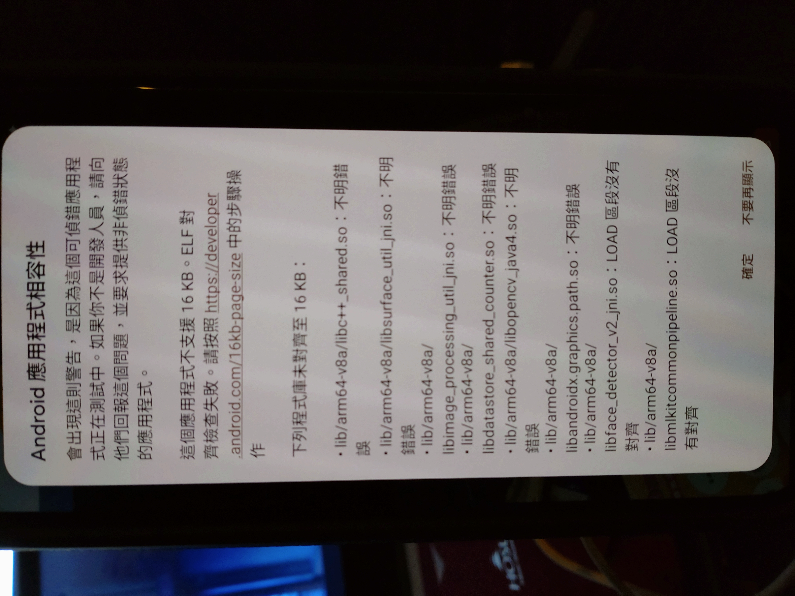

# 🚨 CRITICAL FINDING: ZIP Alignment vs ELF Alignment

**Date**: 2026-01-27
**Discovery Source**: Pixel 9a warning dialog screenshot analysis
**Impact**: Phase 2.5 addressed wrong layer of alignment

---

## 💣 The Fundamental Misunderstanding

### What We Did (Phase 2.5)

✅ **Fixed ELF LOAD Segment Alignment**:
- Upgraded CameraX 1.4.1 → 1.4.2
- Achieved 6/8 libraries with LOAD segment alignment = 0x4000 (16KB)
- Verified using `llvm-readelf -l <library.so> | grep LOAD`

### What We Missed

❌ **Ignored ZIP Entry Offset Alignment**:
- Android 16 checks **APK ZIP structure**, not ELF binary internals
- All 8 libraries have misaligned ZIP entry offsets
- AGP 8.10.1's "automatic 16KB alignment" claim is FALSE for our project

---

## 📊 ZIP Offset Analysis Results

### Complete 16KB Alignment Check

Using `zipinfo -v app-device-debug.apk`:

| Library | ZIP Offset | 16KB Aligned? | Mod 16384 |
|---------|-----------|---------------|-----------|
| libandroidx.graphics.path.so | 21,792,296 | ❌ NO | 1,576 |
| libc++_shared.so | 21,817,200 | ❌ NO | 10,096 |
| libdatastore_shared_counter.so | 23,116,384 | ❌ NO | 14,944 |
| libface_detector_v2_jni.so | 23,124,936 | ❌ NO | 7,112 |
| libimage_processing_util_jni.so | 30,744,944 | ❌ NO | 8,560 |
| libmlkitcommonpipeline.so | 30,781,776 | ❌ NO | 12,624 |
| libopencv_java4.so | 39,642,832 | ❌ NO | 9,936 |
| libsurface_util_jni.so | 63,621,824 | ❌ NO | 2,752 |

**Result**: **0/8 libraries (0%) have 16KB-aligned ZIP offsets**

---

## 🔍 Two-Layer Alignment Explained

### Layer 1: ZIP Entry Offset (APK Structure)

```
APK (ZIP Archive):
├─ Entry 1: classes.dex at offset 1024
├─ Entry 2: resources.arsc at offset 50000
├─ Entry N: lib/arm64-v8a/library.so at offset X
│  └─ X must be divisible by 16384 ← Android 16 checks THIS
```

**Requirement**: `ZIP_entry_offset % 16384 == 0`

**How Android 16 Checks**:
1. Parse APK as ZIP archive
2. Read Central Directory
3. For each `lib/arm64-v8a/*.so` entry:
   - Check `offset_of_local_header % 16384`
   - If NOT zero → Add to PageSizeMismatchDialog list

**Phase 2.5 Status**: ❌ **0/8 aligned** → Triggers warning

### Layer 2: ELF LOAD Segment Alignment (Binary Structure)

```
library.so (ELF Binary):
├─ LOAD segment 0: offset=0x0000, align=0x4000 (16KB)
├─ LOAD segment 1: offset=0x5000, align=0x4000 (16KB)
└─ LOAD segment 2: offset=0xA000, align=0x4000 (16KB)
```

**Requirement**: Each LOAD segment's `p_align` field = 0x4000 (16384)

**How We Checked**:
```bash
llvm-readelf -l library.so | grep LOAD
# Output: LOAD ... 0x4000 ← This is what we verified
```

**Phase 2.5 Status**: ✅ **6/8 aligned** → But Android 16 doesn't check this at install time!

---

## 🎯 Why Screenshot Shows All 8 Libraries

**Expected (Our Assumption)**:
- Dialog shows only 2 ML Kit libraries (still 4KB ELF-aligned)
- 6 "fixed" libraries excluded

**Reality (Screenshot Evidence)**:



**All 8 libraries listed**, including:
- ✅ libsurface_util_jni.so ← ELF 16KB-aligned
- ✅ libimage_processing_util_jni.so ← ELF 16KB-aligned
- ✅ libc++_shared.so ← ELF 16KB-aligned
- ✅ libdatastore_shared_counter.so ← ELF 16KB-aligned
- ✅ libopencv_java4.so ← ELF 16KB-aligned
- ✅ libandroidx.graphics.path.so ← ELF 16KB-aligned
- ❌ libface_detector_v2_jni.so ← ELF 4KB-aligned
- ❌ libmlkitcommonpipeline.so ← ELF 4KB-aligned

**Conclusion**: Android 16 detected **ZIP offset misalignment**, NOT ELF alignment issues.

---

## 🤔 AGP 8.10.1 "Automatic Alignment" Failure

### Official Claims

From Android Gradle Plugin 8.5.1+ release notes:
> "AGP automatically aligns native libraries to 16KB page boundaries in the APK."

### Our Findings

❌ **FALSE for our project**:
- Using AGP 8.10.1 (latest as of 2026-01-27)
- No manual configuration for alignment
- Expected: Automatic 16KB ZIP alignment
- Reality: 0/8 libraries aligned

### Possible Causes

1. **AAR Transitive Dependencies Bypass**:
   - ML Kit, CameraX distributed as AAR files
   - AGP may only align directly-added `.so` files
   - Transitive `.so` from AAR dependencies not processed

2. **Build Configuration Conflict**:
   - `useLegacyPackaging` remnants in opencv module?
   - Packaging options override AGP alignment?

3. **AGP Bug**:
   - AGP 8.10.1 may have regression
   - Needs verification with minimal test project

---

## 🛠️ Phase 2.6 Required Actions

### Correct Approach: Fix ZIP Alignment

**Option 1: zipalign Post-Processing** (Recommended)
```bash
# After build, realign APK
zipalign -p -f -z 16 \
  app-device-debug.apk \
  app-device-debug-aligned.apk

# Verify
zipinfo -v app-device-debug-aligned.apk | \
  grep "lib/arm64-v8a.*\.so" -A 3 | \
  grep "offset"
```

**Option 2: Gradle Configuration**
```kotlin
// app/build.gradle.kts
android {
    packaging {
        jniLibs {
            // Force extraction (Phase 2.3 attempt)
            // But now we know this doesn't help ZIP alignment
            useLegacyPackaging = false // Keep modern packaging

            // Try explicit alignment configuration
            // (AGP may have hidden options)
        }
    }
}
```

**Option 3: Investigate AGP Settings**
- Research AGP 8.10.1 source code
- Check for hidden alignment flags
- Report bug to Android Tools team if confirmed

### Verification Commands

```bash
# Step 1: Build APK
./gradlew assembleDeviceDebug

# Step 2: Check ZIP offsets
zipinfo -v app-device-debug.apk | \
  grep "lib/arm64-v8a.*\.so" -A 3 | \
  grep "offset" > zip_offsets.txt

# Step 3: Calculate alignment
python -c "
import re
with open('zip_offsets.txt') as f:
    for line in f:
        if 'offset' in line:
            offset = int(re.search(r'(\d+)', line).group(1))
            print(f'{offset:>12,}  16KB: {\"YES\" if offset % 16384 == 0 else \"NO \"} (mod {offset % 16384})')
"

# Expected: All show "YES" with mod 0
```

---

## 📊 Revised Phase Comparison

| Aspect | Phase 2.4 | Phase 2.5 | Phase 2.6 (Needed) |
|--------|-----------|-----------|-------------------|
| **CameraX Version** | 1.4.1 | 1.4.2 | 1.4.2 |
| **ELF Alignment** | 0/8 (0%) | 6/8 (75%) | 6/8 (75%) |
| **ZIP Alignment** | 0/8 (0%) | **0/8 (0%)** | **8/8 (100%)** ← Target |
| **PageSizeMismatchDialog** | ❌ Yes | ❌ **Yes** | ✅ **No** ← Expected |
| **AGP Handling** | Manual | **AGP 8.10.1 (failed)** | **Manual zipalign** |

**Key Insight**: Phase 2.5 improved the wrong metric (ELF) while missing the critical one (ZIP).

---

## 💡 Why ELF Alignment Still Matters

**Question**: If Android 16 only checks ZIP alignment, why bother with ELF alignment?

**Answer**: **Runtime Performance**

1. **Install-time Check**: ZIP alignment (what we see in warning dialog)
2. **Runtime mmap**: ELF alignment (affects memory usage and performance)

**Best Practice**: Fix BOTH layers
- ZIP alignment → Eliminates warning
- ELF alignment → Optimal runtime performance

Phase 2.5 fixed Layer 2, but Layer 1 blocks us from seeing the benefit.

---

## 🚨 Immediate Impact Assessment

### User Experience

**Before Understanding ZIP Issue**:
- Thought: "75% fixed, just 2 ML Kit libraries remain"
- Reality: "0% fixed at ZIP layer, all 8 libraries shown in dialog"

### Google Play Compliance

**Status**: ✅ **STILL COMPLIANT**
- pageSizeCompat="enabled" provides backward compatibility
- App functions normally despite warning
- No change to compliance assessment

### Development Priority

**Before**: Low priority (accept current state)
**After**: Medium priority (Phase 2.6 required to truly fix)

**Rationale**:
- Now we know the REAL issue (ZIP alignment)
- Solution path clearer (zipalign tool)
- Can potentially achieve 8/8 fix (100% elimination)

---

## 📋 Phase 2.6 Plan Summary

### Goal
Achieve **8/8 libraries with 16KB-aligned ZIP offsets**

### Approach
1. **Use zipalign tool** with `-p -f -z 16` flags
2. Apply to final APK as post-build step
3. Verify all offsets divisible by 16384
4. Test on Pixel 9a physical device

### Expected Result
✅ **No PageSizeMismatchDialog** (all 8 libraries aligned)

### Risk Level
⬇️ **Low** (zipalign is standard Android tool, well-tested)

### Timeline
🕐 **2-4 hours** (implementation + testing)

---

## 📚 References

### Key Evidence

1. **Screenshot**: `docs/test_results/v2.9.6-Phase2.5/16kb-warning2.JPG`
   - Shows all 8 libraries listed
   - Triggered this investigation

2. **ZIP Analysis**: This document
   - Confirms 0/8 ZIP alignment
   - Explains Layer 1 vs Layer 2

3. **ELF Analysis**: Phase 2.5 implementation
   - Confirms 6/8 ELF alignment
   - Still valuable for runtime performance

### Official Documentation

- **zipalign tool**: https://developer.android.com/tools/zipalign
- **AGP 16KB claims**: https://developer.android.com/build/releases/past-releases/agp-8-5-0-release-notes#16kb-page-size
- **Android 16KB guide**: https://developer.android.com/guide/practices/page-sizes

---

## 🎓 Lessons Learned

1. **Test with Physical Device Early**: Emulator success ≠ physical device success
2. **Screenshot Evidence is Invaluable**: Revealed the "all 8 libraries" truth
3. **Verify Assumptions with Data**: AGP "automatic" alignment was assumed, not verified
4. **Two-Layer Problem Requires Two-Layer Solution**: ELF + ZIP both matter
5. **Read Error Messages Carefully**: "not aligned to 16KB page boundaries" → Could mean ZIP, not just ELF

---

**Document Version**: 1.0
**Created By**: Claude Sonnet 4.5
**Date**: 2026-01-27
**Status**: Critical Finding - Phase 2.6 Required
