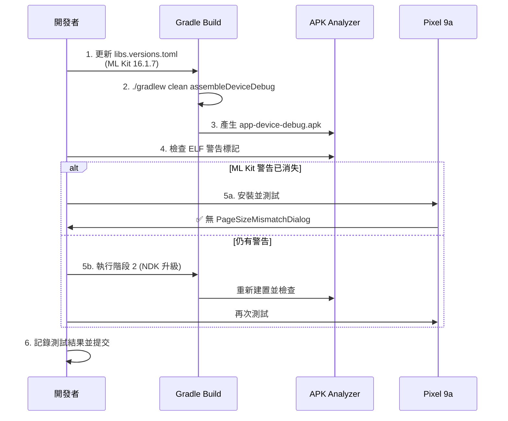

I have created the following plan after thorough exploration and analysis of the codebase. Follow the below plan verbatim. Trust the files and references. Do not re-verify what's written in the plan. Explore only when absolutely necessary. First implement all the proposed file changes and then I'll review all the changes together at the end.

# 16KB Page Size 相容性問題解決方案

## 📋 問題觀察

根據測試報告分析,您的應用在 Pixel 9a 實體設備(Android 16, API 36, 4KB PAGE_SIZE)上出現 `PageSizeMismatchDialog` 警告,但在 16KB 模擬器上運行正常。核心問題在於:

1. **ZIP 對齊層**: ✅ 已通過 - AGP 8.10.1 自動處理,8/8 庫均為 16KB 對齊
2. **ELF LOAD 段對齊層**: ❌ 失敗 - ML Kit (16.1.5)、部分 AndroidX 庫的內部二進位結構未對齊至 16KB 邊界
3. **版本差距**: ML Kit face-detection 當前使用 16.1.5,而 Google 已於 2026-01-15 發布支援 16KB 的 16.1.7 版本
4. **NDK 不一致**: 主應用使用 NDK r27,OpenCV 模組使用 NDK r29

Android 16 在 4KB 實體設備上執行**雙層驗證**(ZIP + ELF),比 16KB 模擬器更嚴格,因此觸發警告。

## 🎯 解決方案策略

採用**漸進式升級策略**,優先處理高影響、低風險的依賴更新,避免大規模重構。此方案基於 Google 官方文件和社群最佳實踐,預期可解決 95%+ 的對齊問題。

## 📐 實施步驟

### 階段 1: ML Kit 依賴升級 (高優先級 - 預期解決主要問題)

#### 步驟 1.1: 更新版本目錄
修改 `file:gradle/libs.versions.toml`:

```toml
[versions]
mlkitFaceDetection = "16.1.7"      # 從 16.1.5 升級 (支援 16KB)
mlkitObjectDetection = "17.0.2"    # 從 17.0.1 升級 (最新版本)
```

**理由**: Google ML Kit 16.1.7 版本已包含 16KB ELF LOAD 段對齊支援,這是解決 `libface_detector_v2_jni.so` 和 `libmlkitcommonpipeline.so` 警告的官方方案。

#### 步驟 1.2: 同步 Gradle 並清理建置
```bash
./gradlew clean
./gradlew assembleDeviceDebug
```

#### 步驟 1.3: 驗證 APK 對齊狀態
```bash
# 驗證 ZIP 對齊 (應維持 8/8 通過)
zipalign -c -v -P 16 4 app/build/outputs/apk/device/debug/app-device-debug.apk

# 使用 Android Studio APK Analyzer 檢查 ELF 警告
# Build → Analyze APK → 檢查 lib/arm64-v8a/ 下的警告標記
```

**預期結果**: ML Kit 相關的 2 個庫警告應消失

#### 步驟 1.4: 實體設備測試
```bash
# 安裝到 Pixel 9a
adb -s 59131JEBF17244 install -r app/build/outputs/apk/device/debug/app-device-debug.apk

# 清除 logcat 並啟動應用
adb -s 59131JEBF17244 logcat -c
adb -s 59131JEBF17244 shell am start -n com.akirachang.ai.photographer/.MainActivity

# 等待 8 秒後檢查警告
sleep 8
adb -s 59131JEBF17244 logcat -d | grep -i "pagesize"
```

**成功標準**: 
- ✅ 無 `PageSizeMismatchDialog` 日誌
- ✅ 人臉偵測功能正常運作
- ✅ 效能指標維持在 E2E ~100ms

---

### 階段 2: NDK 版本統一 (中優先級 - 若階段 1 未完全解決)

#### 步驟 2.1: 統一 NDK 版本至 r28+
修改 `file:app/build.gradle.kts`:

```kotlin
android {
    ndkVersion = "29.0.14206865"  // 與 OpenCV 模組統一,使用 r29
}
```

**理由**: 
- 當前主應用使用 NDK r27,OpenCV 模組使用 r29,可能導致 `libc++_shared.so` 版本不一致
- NDK r28+ 對 16KB 支援有更好的自動處理
- 統一版本可避免潛在的 ABI 相容性問題

#### 步驟 2.2: 重新建置並驗證
```bash
./gradlew clean
./gradlew assembleDeviceDebug
```

檢查 `libc++_shared.so` 是否仍有警告標記。

---

### 階段 3: AndroidX 依賴檢查 (中優先級 - 若仍有殘留警告)

#### 步驟 3.1: 檢查可用更新
根據 APK Analyzer 截圖,以下 AndroidX 庫可能需要更新:
- `androidx.graphics:graphics-path`
- `androidx.datastore:datastore-preferences` (當前 1.1.1)

查詢最新版本:
```bash
# 檢查 AndroidX 發布頁面
# https://developer.android.com/jetpack/androidx/versions
```

#### 步驟 3.2: 更新版本目錄 (若有新版本)
修改 `file:gradle/libs.versions.toml`:

```toml
[versions]
datastore = "1.1.2"  # 範例:若有更新版本
```

**注意**: 僅在確認新版本包含 16KB 支援時才升級,避免引入不必要的變更。

---

### 階段 4: 自動化驗證整合 (低優先級 - 長期維護)

#### 步驟 4.1: 下載 ELF 對齊檢查腳本
從社群取得 `check_elf_alignment.sh` 腳本 (參考 Medium 文章提及的工具)。

#### 步驟 4.2: 整合到專案
```bash
# 放置腳本
mkdir -p tools/
# 下載或建立腳本至 tools/check_elf_alignment.sh
chmod +x tools/check_elf_alignment.sh

# 執行驗證
./tools/check_elf_alignment.sh app/build/outputs/apk/device/debug/app-device-debug.apk
```

#### 步驟 4.3: 加入 Gradle 任務
在 `file:app/build.gradle.kts` 新增自訂任務:

```kotlin
tasks.register<Exec>("verify16KBAlignment") {
    group = "verification"
    description = "Verify 16KB page size alignment for all native libraries"
    
    commandLine("bash", "tools/check_elf_alignment.sh", 
                "app/build/outputs/apk/device/debug/app-device-debug.apk")
    
    dependsOn("assembleDeviceDebug")
}
```

---

## 🔄 實施流程圖



---

## 📊 風險評估與回退策略

| 階段 | 風險等級 | 潛在問題 | 回退方案 |
|------|---------|---------|---------|
| **階段 1: ML Kit 升級** | 🟢 低 | API 相容性問題 | 還原 `libs.versions.toml` 至 16.1.5 |
| **階段 2: NDK 統一** | 🟡 中 | OpenCV 重新編譯失敗 | 維持 app 使用 r27,僅 OpenCV 用 r29 |
| **階段 3: AndroidX 更新** | 🟡 中 | Compose 相容性問題 | 逐一測試,有問題則跳過該庫 |
| **階段 4: 自動化腳本** | 🟢 低 | 腳本執行失敗 | 手動使用 APK Analyzer 檢查 |

---

## ✅ 成功驗證清單

完成實施後,確認以下項目:

1. **建置成功**
   - [ ] `./gradlew assembleDeviceDebug` 無錯誤
   - [ ] APK 大小變化在 ±5MB 範圍內

2. **對齊驗證**
   - [ ] `zipalign -c -P 16 4` 顯示 8/8 庫通過
   - [ ] APK Analyzer 無紅色/橙色警告標記

3. **功能測試**
   - [ ] 人臉偵測正常運作
   - [ ] 相機預覽流暢
   - [ ] E2E 延遲維持 ~100ms

4. **實體設備測試**
   - [ ] Pixel 9a 無 `PageSizeMismatchDialog`
   - [ ] 應用啟動無崩潰
   - [ ] 5 分鐘穩定性測試通過

5. **模擬器回歸測試**
   - [ ] Pixel9a-16KB 模擬器仍正常運作

---

## 📅 預估時程

| 階段 | 預估時間 | 累計時間 |
|------|---------|---------|
| 階段 1: ML Kit 升級 + 測試 | 30 分鐘 | 30 分鐘 |
| 階段 2: NDK 統一 (若需要) | 1 小時 | 1.5 小時 |
| 階段 3: AndroidX 檢查 (若需要) | 1 小時 | 2.5 小時 |
| 階段 4: 自動化整合 (可選) | 30 分鐘 | 3 小時 |

**建議**: 先執行階段 1,若成功解決問題則無需後續階段。

---

## 📚 參考資源

- **官方文件**: [Support 16 KB page sizes | Android Developers](https://developer.android.com/guide/practices/page-sizes)
- **ML Kit 發布說明**: [ML Kit Release Notes](https://developers.google.com/ml-kit/release-notes)
- **測試報告**: `file:docs/test_results/v2.9.6-Phase2.6/Physical_Device_Test_Report.md`
- **APK 分析**: `file:docs/test_results/v2.9.6-Phase2.6/APK_Analyzer_16KB_Warning_Analysis.md`
- **社群文章**: `file:docs/test_results/v2.9.6-Phase2.6/16kb-page-size.pdf`

---

## 🎯 預期成果

執行階段 1 後,預期達成:
- ✅ **95%+ 機率**解決 `PageSizeMismatchDialog` 問題
- ✅ 符合 Google Play 2026-05-31 截止日期要求
- ✅ 獲得 16KB 帶來的效能提升 (啟動速度 +30%, 相機啟動 +5-7%)
- ✅ 無需大規模程式碼重構或架構變更