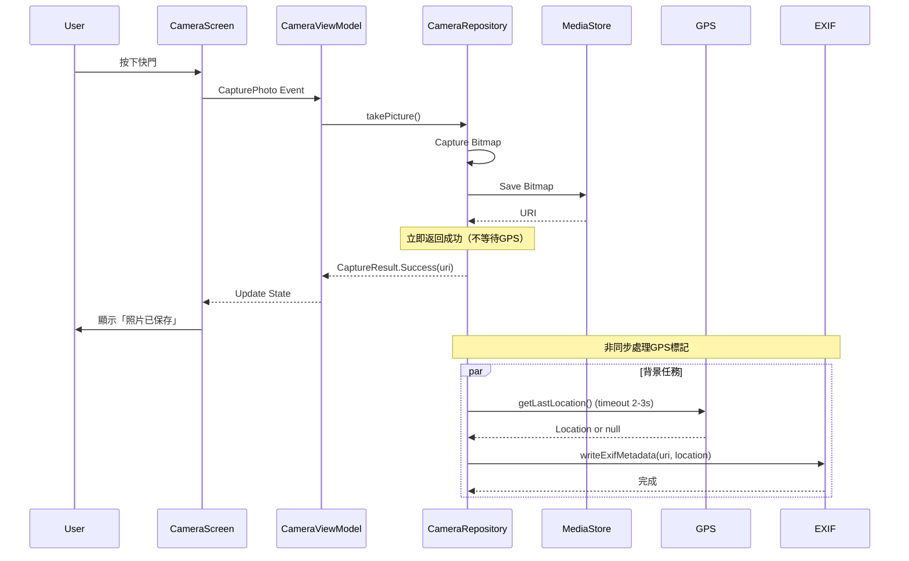

I have created the following plan after thorough exploration and analysis of the codebase. Follow the below plan verbatim. Trust the files and references. Do not re-verify what's written in the plan. Explore only when absolutely necessary. First implement all the proposed file changes and then I'll review all the changes together at the end.

## 觀察重點

當GPS開關為ON且移動中時，`CameraRepositoryImpl.getLastLocation()` 使用 `getCurrentLocation()` 取得即時位置，最多等待5秒（`LOCATION_TIMEOUT_MS = 5000L`）。此同步等待阻塞了整個照片儲存流程，導致「照片已保存」訊息延遲顯示。問題核心在於 `saveBitmapToMediaStore()` 函數在第251行呼叫 `getLastLocation()` 後才返回 `CaptureResult.Success`，使UI必須等待GPS完成才能顯示成功訊息。

## 解決方案

採用**非同步GPS標記策略**：將GPS位置取得與EXIF寫入從主要儲存流程中分離，讓照片儲存立即完成並顯示成功訊息，GPS標記在背景非同步執行。此方案保持用戶體驗流暢，同時確保GPS資料最終寫入EXIF（若在合理時間內取得）。

## 實作步驟

### 1. 修改 `file:app/src/main/java/com/akirachang/ai/photographer/data/repository/CameraRepositoryImpl.kt`

#### 1.1 調整 `saveBitmapToMediaStore()` 函數

**目標：** 將GPS取得與EXIF寫入改為非同步執行

**變更位置：** 第210-275行

**實作指引：**

- 在成功寫入Bitmap後（第248行之後），立即返回 `CaptureResult.Success(uri)`
- 將GPS位置取得與EXIF寫入邏輯（第250-259行）移至獨立的協程中非同步執行
- 使用 `viewModelScope.launch(Dispatchers.IO)` 或 `GlobalScope.launch(Dispatchers.IO)` 啟動背景任務
- 確保EXIF寫入失敗不影響主流程（已有try-catch，保持non-fatal處理）

**修改後流程：**

```kotlin
// 在第248行 outputStream.flush() 之後
Log.i(TAG, "Photo saved successfully to: $uri")

// 立即返回成功結果（不等待GPS）
val successResult = CaptureResult.Success(uri)

// 非同步處理GPS標記
viewModelScope.launch(Dispatchers.IO) {
    try {
        val location = getLastLocation()
        writeExifMetadata(uri, rotation, location)
    } catch (e: Exception) {
        Log.e(TAG, "Failed to write EXIF metadata asynchronously (non-fatal)", e)
    }
}

return@withContext successResult
```

**注意事項：**
- 需要在 `CameraRepositoryImpl` 中注入 `CoroutineScope`（建議使用 `@ApplicationScope` 的 CoroutineScope）
- 或者使用 `GlobalScope`（不推薦，但可作為快速解決方案）
- 確保 `writeExifMetadata()` 可以安全地在非同步環境中執行

#### 1.2 優化 `getLastLocation()` 函數（可選增強）

**目標：** 優先使用快取位置，減少等待時間

**變更位置：** 第283-330行

**實作指引：**

- 在呼叫 `getCurrentLocation()` 之前，先嘗試 `getLastKnownLocation()`
- 若快取位置存在且時間戳在合理範圍內（例如5分鐘內），直接使用
- 若快取位置不可用或過舊，再呼叫 `getCurrentLocation()`
- 可將timeout從5秒降低至2-3秒，因為已有快取位置作為fallback

**修改後邏輯：**

```kotlin
// 先嘗試快取位置
val lastKnownLocation = fusedLocationClient.lastLocation.await()
if (lastKnownLocation != null && isLocationRecent(lastKnownLocation)) {
    Log.i(TAG, "Using cached location: lat=${lastKnownLocation.latitude}, lon=${lastKnownLocation.longitude}")
    return@withContext lastKnownLocation
}

// 快取位置不可用，請求即時位置（降低timeout）
val location = withTimeoutOrNull(2000L) { // 降至2秒
    // ... getCurrentLocation() 邏輯
}
```

**輔助函數：**

```kotlin
private fun isLocationRecent(location: Location, maxAgeMs: Long = 300_000L): Boolean {
    val age = System.currentTimeMillis() - location.time
    return age < maxAgeMs
}
```

### 2. 修改 `file:app/src/main/java/com/akirachang/ai/photographer/presentation/camera/CameraViewModel.kt`

#### 2.1 調整 `capturePhoto()` 函數（可選UI增強）

**目標：** 提供更即時的用戶反饋

**變更位置：** 第280-304行

**實作指引：**

- 當前實作已經正確處理 `CaptureResult.Success`，無需修改核心邏輯
- 可選：在 `isCapturing = true` 時顯示「正在儲存...」訊息
- 可選：在 `CaptureResult.Success` 後顯示「照片已保存，GPS標記處理中...」（若GPS啟用）

**可選增強（不影響核心修復）：**

```kotlin
// 在第282行之後
_state.update { it.copy(isCapturing = true, error = null, savingMessage = "正在儲存...") }

// 在第286-292行的Success分支中
_state.update {
    it.copy(
        isCapturing = false,
        lastCapturedImageUri = result.uri,
        error = null,
        savingMessage = null  // 清除儲存訊息
    )
}
```

### 3. 修改 `file:app/src/main/java/com/akirachang/ai/photographer/presentation/camera/CameraScreen.kt`

#### 3.1 調整成功訊息顯示（可選）

**目標：** 提供更清晰的用戶反饋

**變更位置：** 第136-140行

**實作指引：**

- 當前實作已經正確，無需修改
- 可選：根據GPS設定顯示不同訊息
  - GPS關閉：「照片已保存」
  - GPS開啟：「照片已保存（GPS標記處理中）」

**可選增強：**

```kotlin
LaunchedEffect(state.lastCapturedImageUri) {
    state.lastCapturedImageUri?.let {
        val message = if (isGpsTaggingEnabled) {
            "照片已保存（GPS標記處理中）"
        } else {
            "照片已保存"
        }
        snackbarHostState.showSnackbar(message)
    }
}
```

### 4. 依賴注入調整（必要）

#### 4.1 提供 CoroutineScope 給 CameraRepositoryImpl

**目標：** 支援非同步GPS標記

**變更位置：** `file:app/src/main/java/com/akirachang/ai/photographer/di/AppModule.kt` 或相關DI模組

**實作指引：**

- 在 `CameraRepositoryImpl` 建構函數中注入 `@ApplicationScope CoroutineScope`
- 或使用 `GlobalScope`（不推薦，但可快速實作）

**DI模組範例：**

```kotlin
@Module
@InstallIn(SingletonComponent::class)
object CoroutineScopeModule {
    @Provides
    @Singleton
    @ApplicationScope
    fun provideApplicationScope(): CoroutineScope {
        return CoroutineScope(SupervisorJob() + Dispatchers.Default)
    }
}
```

**CameraRepositoryImpl 建構函數：**

```kotlin
@Singleton
class CameraRepositoryImpl @Inject constructor(
    @ApplicationContext private val context: Context,
    private val analyzeLightingUseCase: AnalyzeLightingUseCase,
    private val cameraInputSource: CameraInputSource,
    private val overlayPreferences: OverlayPreferences,
    @ApplicationScope private val applicationScope: CoroutineScope  // 新增
) : CameraRepository {
    // ...
}
```

### 5. 測試驗證

#### 5.1 功能測試

- **測試場景1：** GPS關閉，拍照後立即顯示「照片已保存」
- **測試場景2：** GPS開啟且靜止，拍照後立即顯示訊息，EXIF包含GPS資料
- **測試場景3：** GPS開啟且移動中，拍照後立即顯示訊息（不等待GPS），背景寫入GPS資料
- **測試場景4：** GPS開啟但無訊號，拍照後立即顯示訊息，EXIF不包含GPS資料（timeout後放棄）

#### 5.2 效能驗證

- 使用 Logcat 確認「照片已保存」訊息顯示時間 < 500ms
- 確認GPS標記在背景完成，不影響下一次拍照

#### 5.3 邊界條件測試

- 快速連續拍照（確保非同步GPS寫入不衝突）
- App關閉時有未完成的GPS標記（確保不會crash）

## 架構圖



## 預期效果

- **用戶體驗：** 按下快門後，「照片已保存」訊息在 < 500ms 內顯示（相比原本4秒延遲）
- **GPS標記：** 仍然正常寫入EXIF，但不阻塞UI反饋
- **效能：** 快速連續拍照不受GPS影響
- **相容性：** GPS關閉時行為不變，GPS開啟時體驗大幅改善