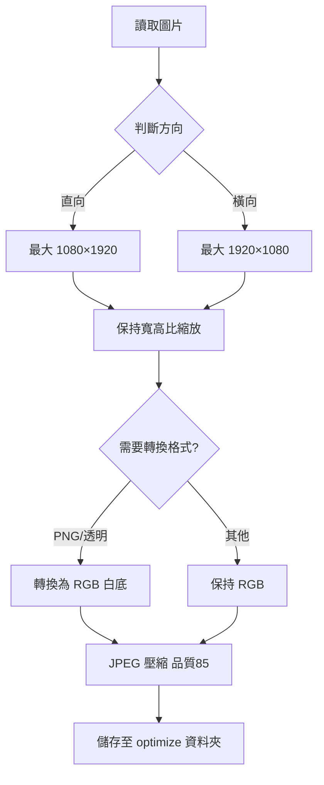

# 圖片優化工具 - Python GUI 版本

## 🎯 功能特色

✅ **GUI 介面** - 直覺的圖形化操作介面
✅ **目錄選擇** - 自由選擇來源圖片目錄
✅ **自動輸出** - 輸出至 `[來源目錄]/optimize/` 子目錄
✅ **批次處理** - 一次處理整個資料夾
✅ **尺寸調整** - 自動調整至適合手機螢幕的尺寸
✅ **高品質壓縮** - JPEG 品質 85，保留細節
✅ **即時日誌** - 顯示每個檔案的處理結果

---

## 📋 系統需求

### 必要環境
- **Python 3.8+** (已安裝 Python 3.14 ✅)
- **Pillow** (PIL Fork) - 圖片處理函式庫

### 安裝依賴

```bash
# 安裝 Pillow
pip install Pillow
```

---

## 🚀 使用方式

### 方法 1: 直接執行（推薦）

雙擊檔案：
```
optimize-test-images.pyw
```

✅ **不會顯示黑色主控台視窗**
✅ **直接啟動 GUI 介面**

### 方法 2: 從命令列執行

```bash
# 使用 pythonw (無視窗)
pythonw optimize-test-images.pyw

# 或使用 python (會有主控台，適合除錯)
python optimize-test-images.pyw
```

---

## 📐 處理規則

### 尺寸調整規則

| 圖片方向 | 最大尺寸 | 說明 |
|---------|---------|------|
| **直向** (高 > 寬) | 1080 × 1920 | 適配直向手機螢幕 |
| **橫向** (寬 ≥ 高) | 1920 × 1080 | 適配橫向顯示 |

### 處理邏輯



### 壓縮設定

- **JPEG 品質**: 85 (0-100)
- **縮放演算法**: LANCZOS (高品質)
- **優化**: 啟用 JPEG 優化
- **格式轉換**: 所有圖片統一輸出為 `.jpg`

---

## 🎨 介面說明

### GUI 佈局

```
┌──────────────────────────────────────────┐
│  🖼️  圖片優化工具                         │
│  調整尺寸 • 壓縮檔案 • 批次處理            │
├──────────────────────────────────────────┤
│  ┌─ 目錄設定 ─────────────────────────┐  │
│  │ 來源目錄： [路徑]      [📁 選擇目錄] │  │
│  │ 輸出目錄： [路徑]/optimize/         │  │
│  └─────────────────────────────────────┘  │
│  ┌─ 優化設定 ─────────────────────────┐  │
│  │ 直向: 1080×1920 | 橫向: 1920×1080  │  │
│  │ JPEG 品質: 85                       │  │
│  └─────────────────────────────────────┘  │
│  ┌─ 處理日誌 ─────────────────────────┐  │
│  │ [時間] [✓] 處理: image.png          │  │
│  │   原始尺寸: 4000x3000               │  │
│  │   ✓ 4000×3000 → 1920×1440          │  │
│  │      2400KB → 480KB (-80%)          │  │
│  │   儲存為: opt-image.jpg             │  │
│  └─────────────────────────────────────┘  │
│  [▶ 開始處理]    [清除日誌]    [關閉]    │
│  就緒                                     │
└──────────────────────────────────────────┘
```

---

## 📝 使用步驟

### 1️⃣ 選擇來源目錄
1. 點擊「📁 選擇目錄」按鈕
2. 瀏覽並選擇包含圖片的資料夾
3. 工具會自動：
   - 掃描圖片數量
   - 設定輸出目錄為 `[來源]/optimize/`

### 2️⃣ 確認設定
- 檢查來源目錄路徑
- 確認輸出目錄（自動建立）
- 查看優化設定（固定參數）

### 3️⃣ 開始處理
1. 點擊「▶ 開始處理」按鈕
2. 確認處理對話框
3. 等待處理完成
4. 查看日誌了解每個檔案的處理結果

### 4️⃣ 檢查結果
- 開啟 `[來源目錄]/optimize/` 資料夾
- 所有優化後的圖片都在此目錄
- 檔名格式：`opt-原檔名.jpg`（自動轉小寫）
- **`opt-` 前綴的好處**：
  - ✅ 容易識別已優化的檔案
  - ✅ 避免與原始檔案混淆
  - ✅ 批次處理時更好管理

---

## 💡 實際範例

### 輸入範例
```
D:\Photos\TestImages\
├── IMG_001.PNG      (4000 × 3000, 2.5 MB)
├── photo_002.jpg    (6000 × 4000, 3.8 MB)
└── screenshot.png   (1080 × 2340, 1.2 MB)
```

### 處理後
```
D:\Photos\TestImages\
├── optimize\
│   ├── opt-img_001.jpg      (1920 × 1440, 480 KB)  # opt- 前綴
│   ├── opt-photo_002.jpg    (1920 × 1280, 520 KB)  # opt- 前綴
│   └── opt-screenshot.jpg   (1080 × 2340, 380 KB)  # opt- 前綴
└── [原始檔案保持不變]
```

**檔名規則**：
- ✅ 統一轉為小寫
- ✅ 加上 `opt-` 前綴（optimize 的縮寫）
- ✅ 統一副檔名為 `.jpg`

---

## 🔧 技術細節

### 支援的圖片格式

**輸入格式**:
- `.jpg` / `.jpeg`
- `.png`
- `.bmp`
- `.gif`
- `.webp`

**輸出格式**:
- `.jpg` (統一格式)

### 特殊處理

1. **透明背景**: PNG 透明背景會轉換為白色背景
2. **檔名處理**:
   - 自動轉換為小寫
   - 加上 `opt-` 前綴
   - 統一副檔名為 `.jpg`
3. **尺寸檢查**: 已符合尺寸的圖片僅進行壓縮
4. **錯誤處理**: 個別檔案錯誤不影響其他檔案

---

## 🆚 與 PowerShell 版本比較

| 項目 | PowerShell 版本 | Python GUI 版本 |
|------|----------------|-----------------|
| 介面 | 命令列 | GUI 視窗 |
| 目錄選擇 | 固定路徑 | 自由選擇 |
| 輸出位置 | 固定路徑 | 自動子目錄 |
| 跨平台 | ❌ 僅 Windows | ✅ Win/Mac/Linux |
| 即時預覽 | ❌ | ✅ |
| 主控台視窗 | ✅ 顯示 | ❌ 隱藏 (.pyw) |
| 處理結果 | 文字顯示 | 圖形化日誌 |

---

## 🐛 疑難排解

### 問題 1: 缺少 Pillow 模組

**錯誤訊息**:
```
ModuleNotFoundError: No module named 'PIL'
```

**解決方法**:
```bash
pip install Pillow
```

### 問題 2: 圖片處理失敗

**可能原因**:
- 檔案損壞
- 格式不支援
- 檔案權限問題

**解決方法**:
- 查看日誌中的錯誤訊息
- 嘗試單獨處理該檔案
- 確認檔案可正常開啟

### 問題 3: 輸出目錄建立失敗

**可能原因**:
- 權限不足
- 磁碟空間不足

**解決方法**:
- 以管理員身分執行
- 檢查磁碟空間

---

## 📊 效能參考

**處理速度** (依硬體而異):
- 小圖片 (<1MB): ~0.1 秒/張
- 中圖片 (1-5MB): ~0.3 秒/張
- 大圖片 (>5MB): ~0.5 秒/張

**壓縮效果**:
- 平均壓縮率: 60-80%
- PNG → JPG: 通常可減少 70-90%
- JPG → JPG: 通常可減少 40-60%

---

## 📝 版本歷史

### v1.1 (2026-01-15)
- ✨ 輸出檔名新增 `opt-` 前綴，更容易識別優化檔案
- 📝 範例：`IMG_001.PNG` → `opt-img_001.jpg`

### v1.0 (2026-01-15)
- 🎉 首次發布 Python GUI 版本
- ✅ 完整移植 PowerShell 版本功能
- ✅ 新增 GUI 介面
- ✅ 支援自由選擇來源目錄
- ✅ 自動建立 optimize 子目錄
- ✅ 使用 `.pyw` 副檔名隱藏主控台
- ✅ 非同步處理，避免 GUI 凍結
- ✅ 詳細的處理日誌與統計

---

## 📄 授權

本工具為開源專案，可自由使用與修改。

---

## 🔗 相關檔案

- `optimize-test-images.pyw` - Python GUI 版本主程式
- `optimize-test-images.ps1` - PowerShell 命令列版本
- `UsbDevTool_Enhanced.pyw` - ADB 裝置管理工具

---

**開發者**: AkiraChang
**最後更新**: 2026-01-15
